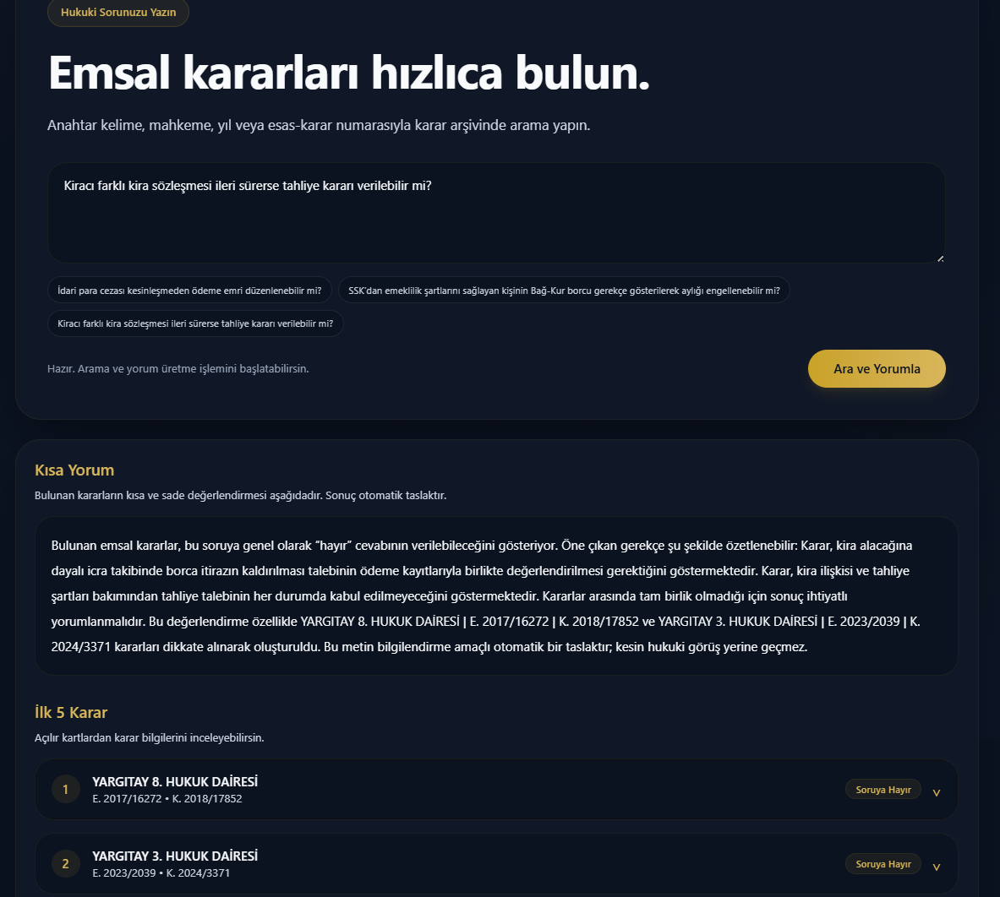
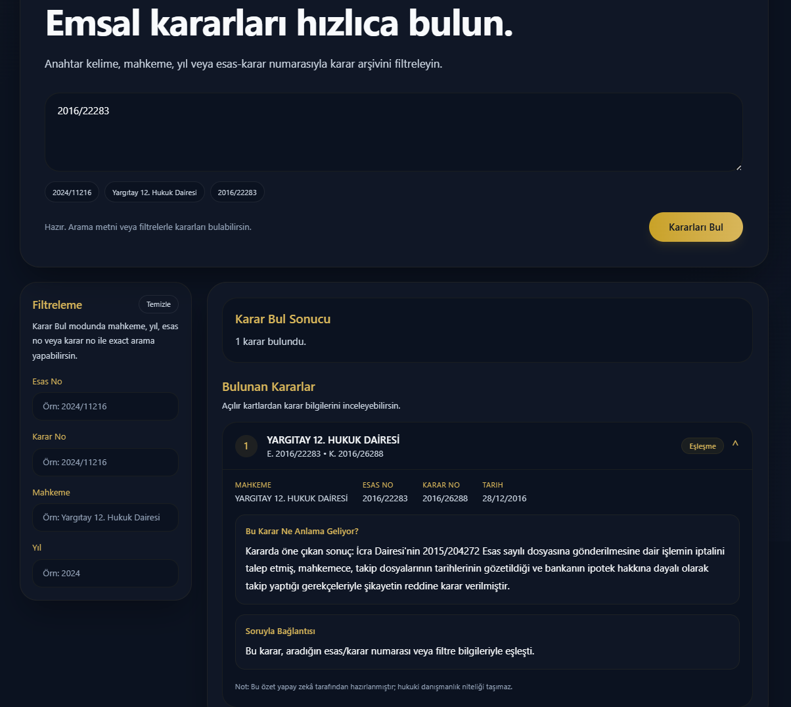
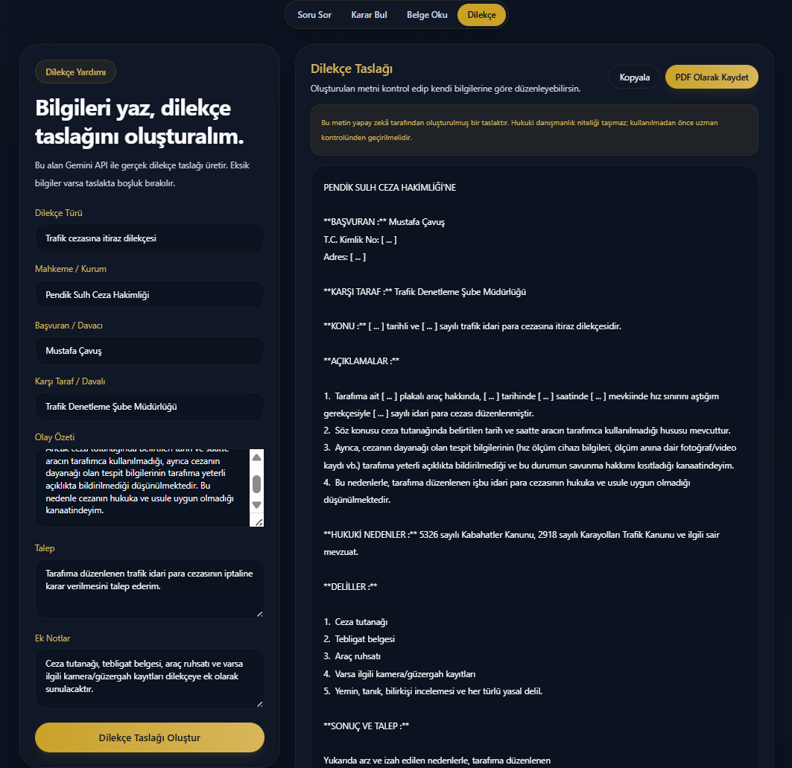
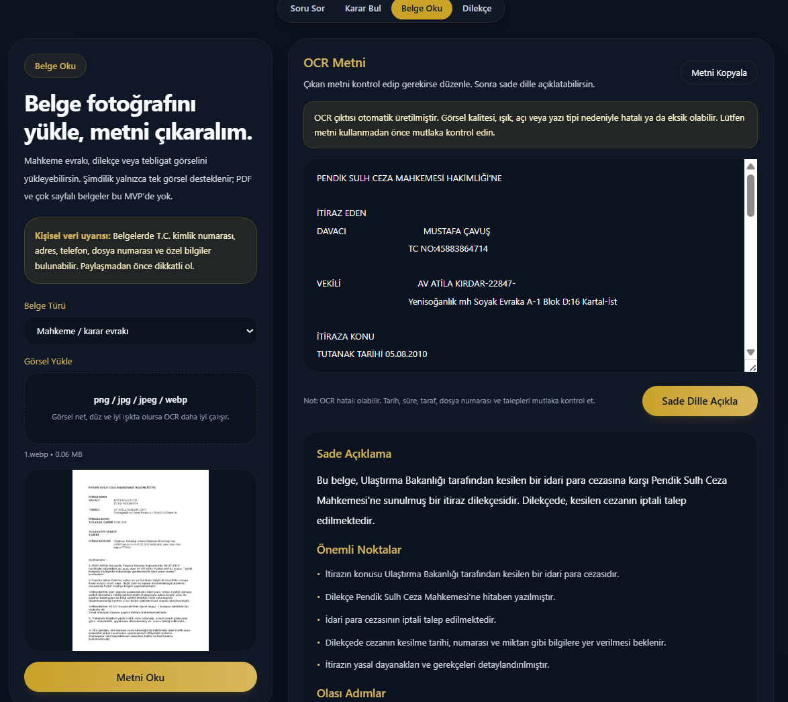
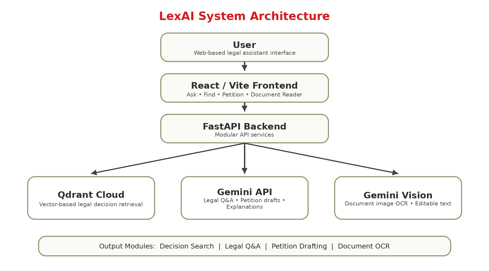

# LexAI — AI-Assisted Legal Research and Document Tools

LexAI is a full-stack **academic prototype** for exploring Turkish court decisions, drafting petitions, and understanding legal documents. It combines semantic retrieval from a Qdrant vector database with relevance ranking and Gemini-powered text generation.

> **Disclaimer:** LexAI is an experimental educational project, **not a legal advice service**. Generated answers and petitions may be inaccurate or incomplete. Verify every cited decision and consult a qualified legal professional for real cases.

## Features

| Module                   | What it does                                                                                                      |
| ------------------------ | ----------------------------------------------------------------------------------------------------------------- |
| **Ask a Legal Question** | Searches a collection of court decisions, ranks relevant evidence, and produces a provisional summary.            |
| **Find Court Decisions** | Retrieves and ranks relevant decisions using a free-text query and optional metadata filters.                     |
| **Petition Drafting**    | Generates a first draft of a petition from user-provided information.                                             |
| **Document Reader**      | Extracts text from an uploaded **PNG/JPG/JPEG/WebP image** with Gemini and provides a plain-language explanation. |

## Preview

| Legal Q&A                          | Case search                          |
| ---------------------------------- | ------------------------------------ |
|  |  |

| Petition drafting                            | Document reader                    |
| -------------------------------------------- | ---------------------------------- |
|  |  |

## Technology Stack

- **Frontend:** React, Vite, Tailwind CSS, JavaScript.
- **Backend:** Python, FastAPI, Pydantic, Uvicorn.
- **Vector Database:** Qdrant Cloud; dense vectors generated by Sentence Transformers.
- **Search and Ranking:** Semantic retrieval, BM25 and lexical ranking signals, Reciprocal Rank Fusion (RRF), and a multilingual cross-encoder reranker.
- **AI Services:** Google Gemini (`google-genai`) for decision interpretation, petition drafting, and image-based text extraction.
- **Testing:** pytest for backend tests and Vite production build for the frontend.

## Architecture



At a high level:

```text
React / Vite UI
     |
     v
FastAPI endpoints
     |
     |-- /ask
     |      |
     |      Qdrant Retrieval
     |      |
     |      Reranking
     |      |
     |      Gemini-assisted Interpretation
     |
     |-- /find
     |      |
     |      Qdrant Retrieval
     |      |
     |      Ranked Court Decisions
     |
     |-- /petition
     |      |
     |      Gemini
     |      |
     |      Draft Text
     |
     |-- /document/ocr
     |      |
     |      Gemini Image Extraction
     |
     |-- /document/explain
            |
            Gemini Plain-language Explanation
```

## Project Structure

```text
lexai_fe/
├── backend/
│   ├── app/
│   │   ├── core/
│   │   ├── routers/
│   │   ├── schemas/
│   │   └── services/
│   ├── tests/
│   ├── requirements.txt
│   ├── requirements-dev.txt
│   ├── upload_to_qdrant_cloud_safe.py
│   └── create_qdrant_indexes.py
├── frontend/
│   ├── public/
│   ├── src/
│   ├── package.json
│   └── vite.config.js
├── docs/
│   └── images/
└── README.md
```

## Running Locally

### Prerequisites

- Python 3.13
- Node.js and npm
- A Qdrant Cloud instance populated with compatible decision vectors
- A Google Gemini API key

The embedding and reranking models may take time and memory to download during the first startup.

### 1. Backend Setup

From the repository root, open a PowerShell terminal:

```powershell
cd backend
py -3.13 -m venv .venv
.\.venv\Scripts\Activate.ps1
python -m pip install -r requirements.txt
```

Create a `backend/.env` file locally.

```dotenv
QDRANT_URL=https://YOUR-CLUSTER-ENDPOINT
QDRANT_API_KEY=YOUR_QDRANT_API_KEY
QDRANT_COLLECTION=hukuk_kararlari_updated

GEMINI_API_KEY=YOUR_GEMINI_API_KEY
```

**Important:** Never commit API keys or your `.env` file to GitHub.

Start the backend:

```powershell
python -m uvicorn app.main:app --port 8000
```

The backend will be available at:

- API: `http://127.0.0.1:8000/`
- Swagger UI: `http://127.0.0.1:8000/docs`

**Note:** Successful API startup does not guarantee that Qdrant or Gemini is accessible. Test a real request after configuration.

### 2. Frontend Setup

Open a second terminal from the repository root.

```powershell
cd frontend
npm ci
```

Create a `frontend/.env` file:

```dotenv
VITE_API_BASE_URL=http://127.0.0.1:8000
```

Start the development server:

```powershell
npm run dev
```

Open the local URL reported by Vite, normally:

`http://localhost:5173`

For non-local deployment, configure the backend CORS allowlist and frontend API URL according to the deployment environment.

Do not expose API keys through frontend environment variables.

## Qdrant Collection Setup

LexAI uses a Qdrant vector database to retrieve relevant Turkish court decisions.

The repository does **not** include the complete legal decision archive or a ready-made vector database.

To reproduce the retrieval system, a separately obtained, lawfully usable JSONL dataset containing legal decision texts and metadata is required.

### Configuration

The project uses:

- 768-dimensional multilingual embeddings
- Cosine similarity
- Sentence Transformers
- Qdrant payload indexing

Add the following additional environment variables to `backend/.env`:

```dotenv
QDRANT_CLOUD_URL=https://YOUR-CLUSTER-ENDPOINT
QDRANT_CLOUD_API_KEY=YOUR_QDRANT_API_KEY

LEXAI_DATA_ROOT=D:\path\to\your\jsonl\dataset
```

### Uploading Decision Data

From the backend directory with the Python environment activated:

```powershell
python upload_to_qdrant_cloud_safe.py
```

The script:

1. Reads JSONL decision files.
2. Skips duplicate decisions.
3. Splits decision texts into overlapping chunks.
4. Generates multilingual embeddings.
5. Creates the Qdrant collection if needed.
6. Uploads vectors and metadata without deleting an existing collection.

After uploading the dataset, create the required payload indexes:

```powershell
python create_qdrant_indexes.py
```

This creates indexes for:

- `document_id` — Keyword
- `chunk_index` — Integer

**Warning:** These commands modify a Qdrant database. Use them only with a cluster and dataset you control.

## Testing

LexAI includes backend unit tests and API validation tests.

### Backend Tests

From the `backend/` directory:

```powershell
python -m pip install -r requirements-dev.txt
python -m pytest tests -v
```

The current local test suite contains 10 passing tests covering:

- Turkish text normalization
- Query term extraction
- JSON response parsing
- Score normalization
- Overlapping text merging
- Document API validation
- Unsupported file handling
- Empty image validation
- Short text rejection
- Mocked document explanation responses

### Frontend Build

From the `frontend/` directory:

```powershell
npm run build
```

The project has successfully completed its local Vite production build.

### Continuous Integration

GitHub Actions automatically runs backend tests and
frontend production build checks on pushes and pull requests.

The CI workflow has been successfully verified on GitHub.

## Known Limitations

LexAI is an academic prototype and remains under development.

### Legal Reliability

- Retrieved decisions may not always be directly relevant to the user's legal question.
- Retrieval scores represent ranking signals, not legal correctness probabilities.
- Generated legal interpretations require independent verification.
- The application is not intended to replace qualified legal advice.

### AI Interpretation

- Gemini may return interpretations for only a subset of retrieved decisions.
- The backend includes fallback mechanisms for incomplete model responses.
- Generated conclusions require additional validation against the original court decisions.

### Document OCR

- Document processing depends on Gemini API availability.
- Temporary service errors, rate limits, or quota restrictions may interrupt processing.
- OCR support currently focuses on PNG, JPEG, and WebP images.
- Direct PDF uploads are not supported by the current OCR endpoint.
- The OCR workflow has not been fully revalidated in the latest recovery tests.

### Petition Generation

- Generated petitions are drafts and must be reviewed before use.
- Some outputs may contain Markdown formatting markers in the exported document.

### Reproducibility

- Legal decision datasets are not included in the repository.
- Qdrant credentials and Gemini API keys must be supplied separately.
- Complete end-to-end execution requires configured external services.

## Roadmap

Future improvements may include:

- More accurate legal decision retrieval and ranking.
- Improved legal citation validation.
- Enhanced Gemini response parsing.
- Better error handling and API retry mechanisms.
- Broader OCR and document format support.
- Improved petition formatting.
- Expanded automated test coverage.
- Additional deployment documentation.

## Legal Data and Licensing

LexAI contains original application code, integrations with third-party services, and references to publicly accessible legal materials.

A public software license has not yet been selected.

Before redistributing code or datasets, the ownership, contributor permissions, and applicable usage rights should be reviewed.

Third-party libraries and models remain subject to their respective licenses.

---

**LexAI** was developed as a computer engineering graduation project and is provided as an educational prototype.
